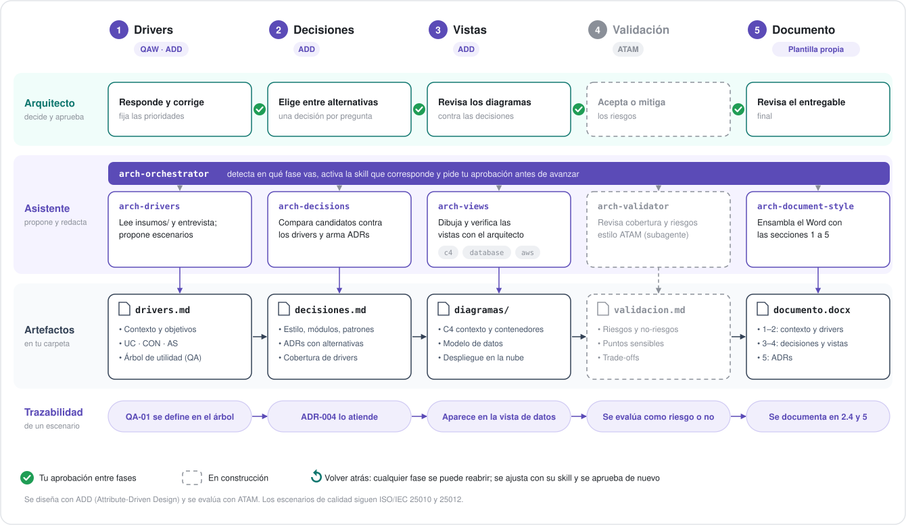

# software-engineering-plugins

**Un asistente de arquitectura de software para Claude Code:** te acompaña desde los drivers arquitectónicos hasta las decisiones (ADR) y el documento de arquitectura, usando ADD para diseñar y ATAM para evaluar.

El arquitecto decide; la IA pregunta, propone, redacta y verifica la coherencia. Tú hablas con un solo agente y él activa las skills de cada fase.

## ¿Qué hace?

El plugin `architecture` conduce el proceso de arquitectura en cinco fases. Cada fase produce un archivo en la carpeta de tu proyecto y requiere tu aprobación antes de pasar a la siguiente.



| # | Fase | Qué produce | Estado |
|---|------|-------------|--------|
| 1 | Drivers | `drivers.md`: contexto, objetivos, casos de uso, restricciones, supuestos y árbol de utilidad con escenarios de calidad | Disponible |
| 2 | Decisiones | `decisiones.md`: estilo, módulos, patrones, base de datos, nube, stack, ADRs y cobertura de drivers | Disponible |
| 3 | Vistas | Diagramas C4, modelo de datos y despliegue | En construcción |
| 4 | Validación | `validacion.md`: riesgos, *trade-offs* y drivers sin atender (estilo ATAM) | En construcción |
| 5 | Documento | Documento de arquitectura en Word | Disponible |

**Principios:**
- **Entrevista breve, no formularios.** Preguntas de 2 o 3 por turno, siempre con una propuesta para aceptar o ajustar.
- **Trazabilidad.** Cada decisión dice qué drivers atiende; la tabla de cobertura muestra lo que falta antes de evaluar.
- **Nada se inventa.** Lo que propone la IA queda marcado como `[Propuesta]` hasta que lo apruebes.

## Inicio rápido

1. Instala el plugin en Claude Code:
   ```
   /plugin marketplace add lara44/software-engineering-plugins
   /plugin install architecture@luisrojas-plugins
   ```
2. Crea una carpeta para tu proyecto (opcional: agrega documentos en `insumos/`, como actas, requisitos o entrevistas) y abre Claude Code en ella:
   ```bash
   mkdir mi-proyecto && cd mi-proyecto
   claude
   ```
3. Escribe: **"Arranquemos la arquitectura de este proyecto"**, o usa `/architecture:arch-orchestrator`.

Para retomar otro día, abre la misma carpeta y escribe **"¿En qué vamos con la arquitectura?"**.

## Actualizar el plugin

Cuando se publica una nueva versión, en Claude Code:

1. Descarga la versión nueva del marketplace:
   ```
   /plugin marketplace update luisrojas-plugins
   ```
2. Actualiza el plugin: abre `/plugin`, entra a los plugins instalados, selecciona `architecture` y elige actualizar.
3. Reinicia Claude Code (`/exit` y luego `claude`), porque las skills se cargan al iniciar la sesión.
4. Verifica en `/plugin` que aparezca la versión nueva.

Si la versión no cambia, reinstálalo:
```
/plugin uninstall architecture@luisrojas-plugins
/plugin install architecture@luisrojas-plugins
```

Tus proyectos no se ven afectados por la actualización: `drivers.md` y `decisiones.md` se conservan y la nueva versión los retoma.

## Ejemplo

<!-- TODO: agregar un ejemplo completo con un caso genérico en examples/ (drivers.md y decisiones.md) y una captura del tablero. -->

```
Proyecto: mi-proyecto
1. Drivers      ✔ aprobada
2. Decisiones   ● en curso
3. Vistas       ○ pendiente
4. Validación   ○ pendiente
5. Documento    ○ pendiente
```

## Skills del plugin `architecture`

Convención de nombres: `arch-<qué>[-style]`. Las skills de **proceso** conducen una fase; las de **estilo** definen cómo debe verse un entregable.

| Skill | Tipo | Para qué |
|---|---|---|
| `arch-orchestrator` | Proceso | Detecta la fase del proyecto, activa la skill que corresponde y pide aprobación entre fases. |
| `arch-drivers` | Proceso (fase 1) | Levanta los drivers con una entrevista breve y produce `drivers.md`. |
| `arch-decisions` | Proceso (fase 2) | Registra las decisiones y los ADRs ligados a los drivers y produce `decisiones.md`. |
| `arch-document-style` | Estilo | Documento de arquitectura en Word (.docx). |
| `arch-c4-diagram-style` | Estilo | Diagramas C4 de contexto, contenedores y componentes en draw.io. |
| `arch-aws-diagram-style` | Estilo | Diagramas de despliegue en AWS en draw.io. |
| `arch-database-diagram-style` | Estilo | Diagramas de modelo de datos en draw.io. |

## Metodología

- **Diseño con ADD** (Attribute-Driven Design): los drivers son los insumos del diseño (funcionalidad primaria, escenarios de calidad y restricciones) y cada decisión declara qué drivers atiende.
- **Evaluación con ATAM**: el árbol de utilidad (atributo → refinamiento → escenario, con prioridad de negocio y dificultad técnica) se construye en la fase 1 y es la base de la validación.
- **Escenarios de calidad** de seis partes: fuente, estímulo, ambiente, artefacto, respuesta y medida.
- **Normas de referencia**: ISO/IEC 25010 para atributos del producto e ISO/IEC 25012 para atributos de datos.

## Instalación en GitHub Copilot CLI

```
copilot plugin marketplace add lara44/software-engineering-plugins
copilot plugin install architecture@luisrojas-plugins
```

Las skills funcionan igual. El orquestador está pensado para Claude Code.

## Requisitos

- Python 3, para los scripts que generan los archivos .drawio.
- Node.js, para generar el documento de arquitectura en Word.
- draw.io Desktop, para exportar los diagramas a PNG (`drawio -x -f png archivo.drawio`).

## Estructura del repositorio

```
.claude-plugin/marketplace.json        Catálogo para Claude Code
.github/plugin/marketplace.json        Catálogo para GitHub Copilot
plugins/<plugin>/
  .claude-plugin/plugin.json           Manifiesto para Claude Code
  .github/plugin/plugin.json           Manifiesto para GitHub Copilot
  skills/<skill>/SKILL.md              Skills del plugin
```

## Contribuir

¿Encontraste un problema o tienes una idea? Abre un *issue* con el caso en el que lo usaste y lo que esperabas que pasara.

### Publicar una nueva versión

1. Modifica las skills del plugin.
2. Sube el número de versión en los tres archivos: `plugins/<plugin>/.claude-plugin/plugin.json`, `plugins/<plugin>/.github/plugin/plugin.json` y la entrada del plugin en `.github/plugin/marketplace.json`.
3. Valida con `claude plugin validate .`
4. Haz commit y push.

Versionado: el número del medio sube cuando se agrega una fase o cambian los nombres de las skills; el último, con ajustes a skills existentes.

Los usuarios reciben la actualización siguiendo los pasos de [Actualizar el plugin](#actualizar-el-plugin).

### Agregar un plugin

1. Crea la carpeta `plugins/<nuevo-plugin>/` con sus dos manifiestos y su carpeta `skills/`.
2. Agrega una entrada en cada catálogo: `.claude-plugin/marketplace.json` y `.github/plugin/marketplace.json`.
3. Usa el mismo `name` en los manifiestos del plugin y en las entradas de los catálogos.
4. Nombra sus skills con el prefijo del plugin, siguiendo la convención `<prefijo>-<qué>[-style]`.

## Autor

Luis Rojas — arquitecto de soluciones.

## Licencia

[MIT](LICENSE). Puedes usar, modificar y compartir estas skills, incluso en proyectos comerciales, siempre que conserves el aviso de copyright.
