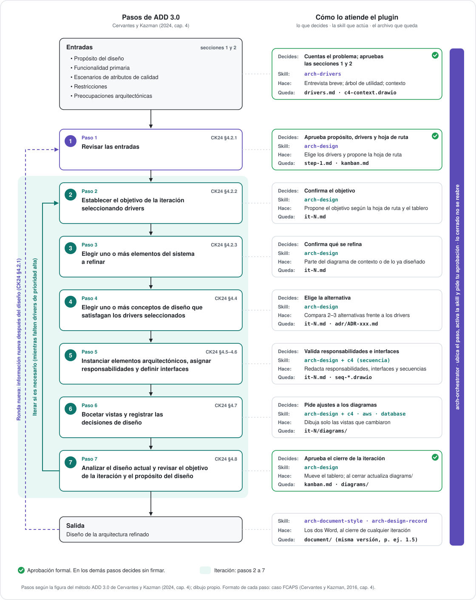

# software-engineering-plugins

**`add`, un asistente de arquitectura de software para Claude Code y GitHub Copilot CLI:** conduce el diseño con el método **ADD 3.0** (Attribute-Driven Design; Cervantes y Kazman, 2024), desde el caso de negocio hasta el documento de arquitectura, iteración por iteración.

El arquitecto decide; el asistente propone, redacta, dibuja y verifica la coherencia. Tú hablas con un solo agente, el orquestador, y él activa la skill que corresponde en cada momento.

## ¿Qué hace?

El plugin sigue las secciones del caso de estudio FCAPS del libro de Cervantes y Kazman. Cada sección produce archivos en la carpeta de tu proyecto y requiere tu aprobación.



A la izquierda, los pasos de ADD 3.0 (Cervantes y Kazman, 2024, cap. 4); a la derecha, lo que decides en cada paso, la skill que actúa y el archivo que queda. Los pasos 2 a 7 se repiten por cada iteración.

| # | Sección | Qué produce |
|---|---------|-------------|
| 1 | Caso de negocio | `drivers.md` (sección 1) y el diagrama de contexto |
| 2 | Requisitos del sistema | `drivers.md` (sección 2): casos de uso, escenarios de calidad con árbol de utilidad, restricciones, preocupaciones y supuestos |
| 3 | Proceso de diseño | Paso 1 de ADD (propósito, drivers, hoja de ruta y tablero) y una iteración por objetivo, con los pasos 2 a 7: decisiones, ADR, diagramas y avance de los drivers. En `iterations/`, `adr/` y `diagrams/` |
| 4 | Análisis | `validation.md` (en construcción) |
| 5 | Documentos | Documento de arquitectura (diseño vigente) y registro de diseño ADD (todas las iteraciones), en Word y con la misma versión |

**Principios:**
- **El modelo propone; el arquitecto decide.** Ninguna decisión, aprobación ni cierre ocurre sin ti.
- **Los archivos demuestran el estado.** Cada respuesta empieza con un bloque de estado que muestra las cinco secciones y, en el proceso de diseño, los siete pasos de la iteración en curso. Cuando hay algo que decidir, la respuesta termina con un bloque "Necesito que decidas".
- **Lo cerrado no se reabre.** Cambiar una decisión es una iteración nueva; información nueva después del diseño abre una ronda nueva. Así queda la historia del diseño.
- **Nada se inventa.** Lo que propone el asistente queda marcado como `[Propuesta]` hasta que lo apruebes; lo que solo sabe el cliente va a `questions.md`.

## Inicio rápido

1. Instala el plugin en Claude Code:
   ```
   /plugin marketplace add lara44/software-engineering-plugins
   /plugin install add@luisrojas-plugins
   ```
2. Crea una carpeta para tu proyecto (opcional: agrega documentos en `inputs/`, como actas, requisitos o entrevistas) y abre Claude Code en ella:
   ```bash
   mkdir mi-proyecto && cd mi-proyecto
   claude
   ```
3. Escribe: **"Arranquemos la arquitectura de este proyecto"**, o usa `/add:start`.

Para retomar otro día, abre la misma carpeta y escribe **"¿En qué vamos con la arquitectura?"**.

## Actualizar el plugin

Cuando se publica una nueva versión, en Claude Code:

1. Descarga la versión nueva del marketplace:
   ```
   /plugin marketplace update luisrojas-plugins
   ```
2. Actualiza el plugin: abre `/plugin`, entra a los plugins instalados, selecciona `add` y elige actualizar.
3. Reinicia Claude Code (`/exit` y luego `claude`), porque las skills se cargan al iniciar la sesión.
4. Verifica en `/plugin` que aparezca la versión nueva.

Si la versión no cambia, reinstálalo:
```
/plugin uninstall add@luisrojas-plugins
/plugin install add@luisrojas-plugins
```

Tus proyectos no se ven afectados por la actualización. Un proyecto de la versión 1.x (con `decisions.md` y `diagrams/views.md`) se detecta al retomarlo: el orquestador propone migrarlo y conserva el diseño anterior como insumo.

**Si tenías instalado `architecture` (versión 1.x):** desde la 2.0 el plugin se llama `add`. Para el marketplace es un plugin distinto, así que no se actualiza solo:
```
/plugin uninstall architecture@luisrojas-plugins
/plugin install add@luisrojas-plugins
```

## Ejemplo

```
ADD 3.0 · Proceso de diseño
  [✔] 1. Caso de negocio
  [✔] 2. Requisitos del sistema
  [>] 3. Proceso de diseño · iteración 2 de 6: Identificar estructuras para la funcionalidad primaria
        [✔] Paso 1: Revisar entradas
        [✔] Paso 2: Objetivo de la iteración
        [✔] Paso 3: Elegir elementos
        [>] Paso 4: Elegir conceptos de diseño · en curso
        [ ] Paso 5: Instanciar elementos, asignar responsabilidades e interfaces
        [ ] Paso 6: Bocetar vistas y registrar decisiones
        [ ] Paso 7: Analizar el diseño y revisar el objetivo
  [ ] 4. Análisis
  [ ] 5. Documentos
```

## Skills del plugin `add`

Cada skill se llama con el nombre del plugin delante (`/add:<skill>`). Las skills de **proceso** conducen una sección; las de **documento** y **diagrama** definen cómo se ve un entregable.

| Comando | Tipo | Para qué |
|---|---|---|
| `/add:start` | Proceso | Arranca o retoma: ubica el proyecto (sección, iteración y paso), activa la skill que corresponde, hace respetar el orden de ADD y pide las aprobaciones. **Es el único que necesitas.** |
| `/add:drivers` | Proceso (secciones 1 y 2) | Caso de negocio y requisitos del sistema con una entrevista breve; produce `drivers.md`, el diagrama de contexto y el de casos de uso. |
| `/add:design` | Proceso (sección 3) | Paso 1 de ADD y las iteraciones con los pasos 2 a 7; produce `iterations/`, `adr/` y los diagramas. |
| `/add:document` | Documento | Documento de arquitectura en Word con el diseño vigente; define el estilo común. |
| `/add:record` | Documento | Registro de diseño ADD en Word, con la estructura del caso FCAPS. |
| `/add:c4` | Diagrama | Diagramas C4 (contexto, contenedores, componentes), de casos de uso y de secuencia en draw.io. |
| `/add:aws` | Diagrama | Diagramas de despliegue en AWS en draw.io. |
| `/add:data` | Diagrama | Diagramas de modelo de datos en draw.io. |

También funcionan con lenguaje natural: *"Arranquemos la arquitectura"*, *"¿En qué vamos con la arquitectura?"*, *"Genera los documentos"*. Usa `/add:start` para el proceso: si llamas otra skill de proceso directamente, te saltas el orden de ADD y las aprobaciones. Las de diagrama sí se pueden usar solas.

## Metodología

- **Diseño con ADD 3.0** (Cervantes y Kazman, 2024, cap. 4): paso 1 para revisar las entradas y elegir los drivers; iteraciones con los pasos 2 a 7 (objetivo, elementos a refinar, conceptos de diseño, instanciación e interfaces, bocetos de las vistas y análisis), y un tablero que muestra el avance de cada driver. La presentación sigue el caso FCAPS (Cervantes y Kazman, 2016, cap. 4).
- **Colaboración modelo–arquitecto**: el modelo propone y el arquitecto supervisa y decide, como en el enfoque de diseño asistido por LLM con ADD de Cervantes, Kazman y Cai (2025).
- **Árbol de utilidad de ATAM** (atributo → refinamiento → escenario, con prioridad de negocio y dificultad técnica) y escenarios de calidad de seis partes.
- **ADR** con al menos dos alternativas reales; un ADR reemplazado cambia de estado, no de contenido (Nygard, 2011).
- **Normas de referencia**: ISO/IEC 25010 para atributos del producto e ISO/IEC 25012 para atributos de datos.

Este plugin aplica el método ADD 3.0 según Cervantes y Kazman (2016, 2024) y el árbol de utilidad de ATAM. No está afiliado ni respaldado por el Software Engineering Institute ni por Carnegie Mellon University. ATAM es marca de servicio de Carnegie Mellon University.

## Instalación en GitHub Copilot CLI

```
copilot plugin marketplace add lara44/software-engineering-plugins
copilot plugin install add@luisrojas-plugins
```

Las skills funcionan igual. Si la herramienta no puede leer imágenes, los diagramas se entregan marcados "sin verificación visual" para que los revises tú.

## Requisitos

- Python 3, para los scripts que generan los archivos .drawio.
- Node.js con la librería `docx`, LibreOffice y poppler, para generar los documentos en Word.
- draw.io Desktop, para exportar los diagramas a PNG (`drawio -x -f png archivo.drawio`).

## Estructura del repositorio

```
.claude-plugin/marketplace.json        Catálogo para Claude Code
.github/plugin/marketplace.json        Catálogo para GitHub Copilot
plugins/<plugin>/
  .claude-plugin/plugin.json           Manifiesto para Claude Code
  .github/plugin/plugin.json           Manifiesto para GitHub Copilot
  skills/<skill>/SKILL.md              Skills del plugin
  skills/<skill>/references/           Detalle que la skill lee solo cuando lo necesita
  skills/<skill>/scripts/              Generadores (diagramas y Word)
```

## Contribuir

¿Encontraste un problema o tienes una idea? Abre un *issue* con el caso en el que lo usaste y lo que esperabas que pasara.

### Publicar una nueva versión

1. Modifica las skills del plugin.
2. Sube el número de versión en los tres archivos: `plugins/<plugin>/.claude-plugin/plugin.json`, `plugins/<plugin>/.github/plugin/plugin.json` y la entrada del plugin en `.github/plugin/marketplace.json`.
3. Valida con `claude plugin validate .`
4. Haz commit y push.

Versionado: el número del medio sube cuando se agrega una fase o cambian los nombres de las skills; el último, con ajustes a skills existentes.

Los usuarios reciben la actualización siguiendo los pasos de [Actualizar el plugin](#actualizar-el-plugin).

### Agregar un plugin

1. Crea la carpeta `plugins/<nuevo-plugin>/` con sus dos manifiestos y su carpeta `skills/`.
2. Agrega una entrada en cada catálogo: `.claude-plugin/marketplace.json` y `.github/plugin/marketplace.json`.
3. Usa el mismo `name` en los manifiestos del plugin y en las entradas de los catálogos.
4. Nombra el plugin por su método (`add`, `arc42`, `c4`…) y sus skills con nombres cortos en inglés (`start`, `design`, `document`…): Claude Code ya les antepone el nombre del plugin (`/<plugin>:<skill>`).

## Autor

Luis Rojas — arquitecto de soluciones.

## Licencia

[MIT](LICENSE). Puedes usar, modificar y compartir estas skills, incluso en proyectos comerciales, siempre que conserves el aviso de copyright.
