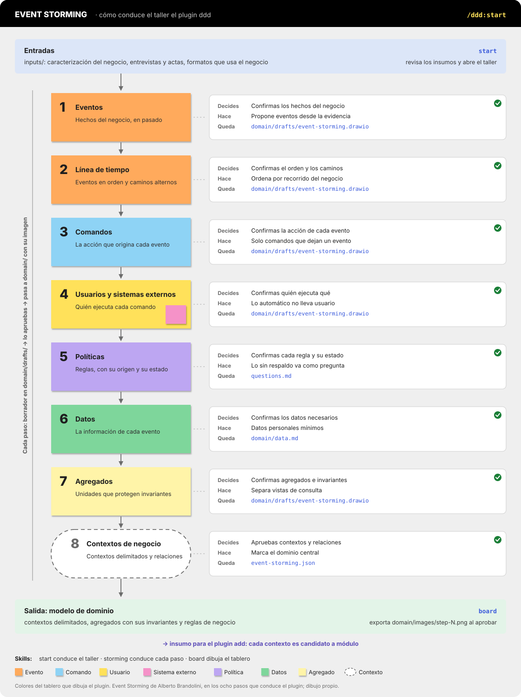

# ddd

**`ddd`, un taller de Event Storming paso a paso para Claude Code:** parte de la caracterización del negocio y termina en el modelo de dominio (contextos delimitados, agregados con sus invariantes y reglas de negocio), dibujado en un solo tablero de draw.io con el estilo de notas adhesivas.

El arquitecto decide; la IA propone desde la evidencia, pregunta y verifica la coherencia. Lo que no tiene respaldo queda marcado como propuesta o como punto por confirmar.

## ¿Qué hace?



El taller tiene ocho fases, una por paso. Cada fase se trabaja como borrador y necesita tu aprobación antes de pasar a la siguiente.

| # | Fase | Qué agrega al tablero |
|---|------|------------------------|
| 1 | Eventos | Todos los hechos del negocio, en pasado y sin orden |
| 2 | Línea de tiempo | Los eventos ordenados por recorrido del negocio, con caminos alternos |
| 3 | Comandos | La acción que origina cada evento |
| 4 | Usuarios y sistemas externos | Quién ejecuta cada comando y con qué sistemas se intercambia información |
| 5 | Políticas | Las reglas, con su origen y su estado (confirmada, supuesto, propuesta o parametrizada) |
| 6 | Datos | La información que necesita cada evento |
| 7 | Agregados | Las unidades que protegen las invariantes; los cálculos y reportes como vistas de consulta |
| 8 | Contextos de negocio | Los contextos delimitados, sin línea de tiempo: un óvalo por contexto con sus agregados y sus relaciones |

En cualquier momento puedes preguntar en qué va el taller:

```
Event Storming: mi-proyecto
1. Eventos                        ✔ aprobado
2. Línea de tiempo                ✔ aprobado
3. Comandos                       ● en curso (borrador)
4. Usuarios y sistemas externos   ○ pendiente
…
```

**El tablero** es un solo archivo `.drawio`: cada paso en su propia página (las pestañas de draw.io), con la terminología y el proceso del taller a la izquierda y el tablero del paso a la derecha. Lo puedes abrir y ajustar a mano en draw.io o en VS Code.

**Borradores y aprobación:** el paso en curso se trabaja en `domain/drafts/`. Al aprobarlo, el borrador pasa a `domain/` y se exporta la imagen de ese paso (`domain/images/step-N.png`).

## Inicio rápido

1. Instala el plugin:
   ```
   /plugin marketplace add lara44/software-engineering-plugins
   /plugin install ddd@luisrojas-plugins
   ```
2. Pon en `inputs/` lo que tengas del negocio: caracterización, entrevistas, formatos, actas.
3. Abre Claude Code en la carpeta y escribe **"Hagamos el Event Storming de este proyecto"**, o usa `/ddd:start`.

Para retomar otro día, abre la misma carpeta y escribe **"¿En qué vamos con el Event Storming?"**.

## Archivos que produce

```
<proyecto>/
├── inputs/
├── questions.md                  ← preguntas para el negocio (puntos por confirmar)
└── domain/
    ├── event-storming.md         ← estado de cada paso y su resumen
    ├── event-storming.json       ← modelo aprobado
    ├── event-storming.drawio     ← tablero aprobado, una página por paso
    ├── data.md                   ← datos por evento (al aprobar el paso 6)
    ├── images/step-N.png         ← imagen de cada paso aprobado
    └── drafts/                   ← el paso en curso, hasta su aprobación
```

## Skills del plugin

Cada skill se llama con el nombre del plugin delante (`/ddd:<skill>`).

| Comando | Tipo | Para qué |
|---|---|---|
| `/ddd:start` | Proceso | Muestra en qué paso va el taller, activa la skill del paso y pide aprobación antes de avanzar. |
| `/ddd:storming` | Proceso | Conduce cada paso desde los insumos, en borrador, con su criterio de cierre. |
| `/ddd:board` | Diagrama | Dibuja el tablero en draw.io y exporta la imagen de cada paso aprobado. |

## Con el plugin `add`

Si también usas el plugin `add` (ADD 3.0), los dos comparten `inputs/` y `questions.md`, y `domain/event-storming.md` sirve de insumo para el proceso de diseño: cada contexto es candidato a módulo. Ninguno de los dos depende del otro.

## Requisitos

- Python 3, para dibujar el tablero.
- draw.io Desktop, para exportar las imágenes al aprobar cada paso (`drawio` en la terminal). Sin él, la imagen se exporta desde el editor.
- Recomendado: la fuente Inter instalada.
